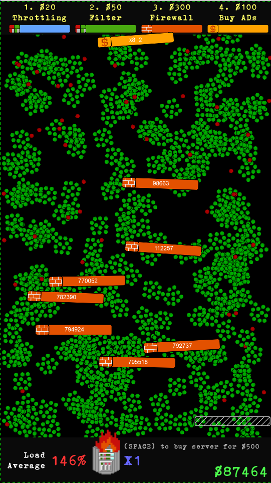
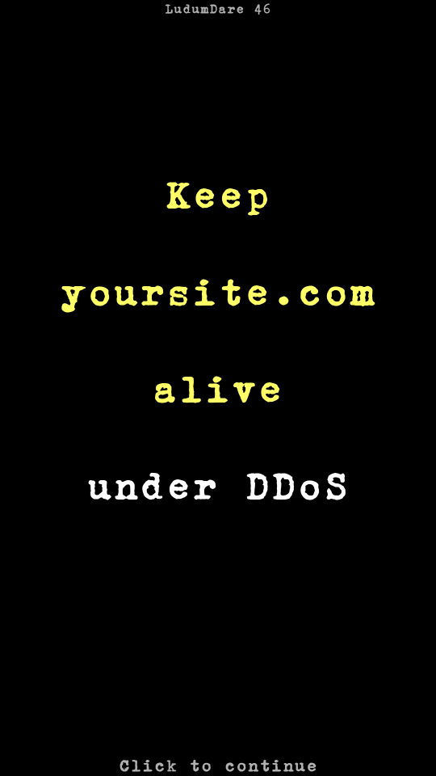
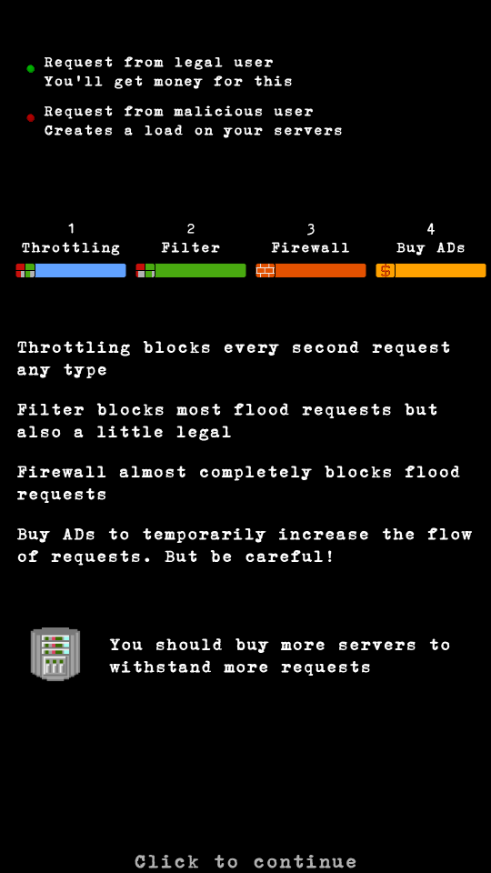

# LudumDare46
My game for [LudumDare 46](https://ldjam.com/events/ludum-dare/46/ddos-is-coming), theme "Keep it alive".



Under the harsh conditions of constant DDoS attacks you have to grow your small web service,
increasing the number of servers and the balance on your account.

There are three tools to defend against attacks, plus the option to buy new servers and advertising.

You have to balance between investing in defense, buying new servers and keeping them from overheating.
If the servers cannot handle the load, they simply burn out, and it is Game Over.

From coming up with the idea to the current version it took about 29 hours of development.

CoronaSDK + Aseprite.

[gameplay video](https://www.youtube.com/watch?v=ElEPUS7UlKA)





## Building for the web (HTML5)

You need the Linux snap of Solar2D (its console builder cannot do HTML5, the build goes through the simulator GUI):

```sh
curl -LO https://github.com/coronalabs/corona/releases/download/3711/Solar2D-Linux-2024.3711_amd64.snap
sudo snap install --dangerous --devmode ./Solar2D-Linux-2024.3711_amd64.snap
```

Then run `./build-html5.sh`: it copies the project to `~/ld46-html5/src` (the snap can only see `$HOME`),
opens the simulator and prints what to enter in the `File → Build → HTML5` dialog (`Ctrl+Alt+B`).
After the simulator is closed the result is in `builds/ddos-is-coming.html5/`.

Running locally (`file://` does not work, http is required):

```sh
./build-html5.sh serve     # or: python3 -m http.server -d builds/ddos-is-coming.html5 8000
```
